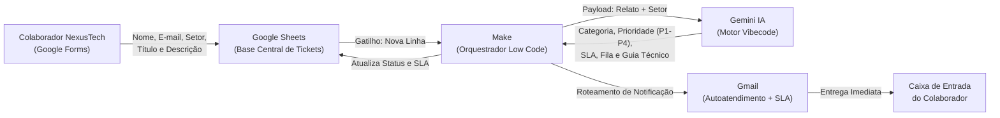

# HelpDesk AI: Triagem Inteligente e Autoatendimento de Chamados por Setor Corporativo

> **Projeto Acadêmico Individual — Paradigmas No Code, Low Code e Vibecode**  
> **Instituição:** Centro Universitário do Distrito Federal (UDF)  
> **Disciplina:** Tendências em Ciência da Computação  
> **Docente:** Profa. Kadidja Valéria  
> **Autor:** Gustavo Negreiros  

---

## Sumário
- [1. Cenário Corporativo e Descrição do Desafio](#1-cenário-corporativo-e-descrição-do-desafio)
- [2. Estrutura Organizacional e Matriz de Criticidade por Setor](#2-estrutura-organizacional-e-matriz-de-criticidade-por-setor)
- [3. Justificativa das Tecnologias e Paradigmas](#3-justificativa-das-tecnologias-e-paradigmas)
- [4. Arquitetura da Solução e Fluxo de Dados](#4-arquitetura-da-solução-e-fluxo-de-dados)
- [5. Evidências do Protótipo Funcional](#5-evidências-do-protótipo-funcional)
- [6. Reflexão Crítica: Vantagens e Limitações](#6-reflexão-crítica-vantagens-e-limitações)
- [7. Organização do Trabalho Individual](#7-organização-do-trabalho-individual)
- [8. Apresentação e Recursos Adicionais](#8-apresentação-e-recursos-adicionais)

---

## 1. Cenário Corporativo e Descrição do Desafio

### A Empresa Hipotética: NexusTech S.A.
Para contextualizar a aplicação em um ambiente real de Engenharia de Software e Gestão de Serviços de TI (ITSM), o protótipo foi projetado para a **NexusTech S.A.**, uma empresa de médio porte do setor de tecnologia financeira e logística que opera com cinco departamentos distintos, cada um possuindo diferentes níveis de tolerância a falhas e Acordos de Nível de Serviço (SLAs).

### O Desafio
No modelo tradicional de Help Desk da NexusTech S.A., todos os chamados caíam em uma fila única e linear. Isso gerava três falhas operacionais graves:
1. **Ausência de Contexto Organizacional:** Uma falha de conectividade no setor Administrativo era tratada na mesma fila que uma queda de sistema no setor de Operações Críticas ou Faturamento.
2. **Tempo Elevado de Primeira Resposta (First Response Time):** Analistas de suporte Nível 1 gastavam grande parte do expediente lendo, classificando manualmente a área afetada e respondendo dúvidas recorrentes.
3. **Subjetividade na Priorização:** Solicitações abertas pelos próprios usuários frequentemente recebiam marcação de urgência máxima sem critério técnico, distorcendo a fila de atendimento.

### A Solução: HelpDesk AI Contextual
O **HelpDesk AI** é um sistema automatizado orientado a eventos que realiza a triagem cognitiva dos chamados da NexusTech S.A. A solução cruza o **relato técnico do incidente** com o **setor corporativo do solicitante**, utilizando Inteligência Artificial Generativa para:
* Classificar a categoria técnica da falha (Hardware, Software, Rede/Infraestrutura ou Acesso/Segurança).
* Calcular dinamicamente a prioridade real (P1 a P4) e o SLA de atendimento com base no impacto de negócio do setor.
* Definir a fila de escalonamento responsável (Nível 1, Nível 2 Infraestrutura ou Nível 2 Sistemas).
* Enviar imediatamente um guia técnico de autoatendimento personalizado para o colaborador.

---

## 2. Estrutura Organizacional e Matriz de Criticidade por Setor

A lógica do sistema considera os seguintes setores da **NexusTech S.A.** para ponderação de impacto pela Inteligência Artificial:

| Setor da Empresa | Impacto de Negócio | Exemplos de Incidentes Críticos | Peso na Priorização (SLA) |
| :--- | :--- | :--- | :--- |
| **1. Operações e Infraestrutura Crítica (NOC)** | Altíssimo (afeta disponibilidade de serviços aos clientes finais) | Queda de servidores, falha em links dedicados, indisponibilidade de banco de dados | Prioridade Elevada (P1 / P2) — SLA de 15 min a 1h |
| **2. Financeiro e Faturamento** | Alto (impacta fluxo de caixa, emissão de notas fiscais e conciliação bancária) | Travamento de ERP, erro em certificado digital, bloqueio em gateway de pagamento | Prioridade Alta (P1 / P2) — SLA de 30 min a 2h |
| **3. Engenharia e Desenvolvimento** | Médio/Alto (paralisa esteiras de desenvolvimento e deploy) | Falha em pipelines CI/CD, bloqueio de chaves SSH/Git, queda de ambiente de homologação | Prioridade Média/Alta (P2 / P3) — SLA de 1h a 4h |
| **4. Comercial e Atendimento (CX)** | Médio (impacta prospecção de vendas e suporte ao cliente externo) | Indisponibilidade de CRM, falha em headset/telefonia VoIP, lentidão de navegador | Prioridade Média (P2 / P3) — SLA de 2h a 6h |
| **5. Recursos Humanos e Administrativo** | Baixo/Moderado (operações internas sem impacto imediato no cliente externo) | Impressora offline, criação de conta para novo colaborador, configuração de pacote Office | Prioridade Padrão (P3 / P4) — SLA de 4h a 24h |

---

## 3. Justificativa das Tecnologias e Paradigmas

| Paradigma | Ferramenta Adotada | Papel no Sistema | Justificativa Técnica |
| :--- | :--- | :--- | :--- |
| **No Code** | **Google Forms** e **Google Sheets** | Portal de abertura de chamados por setor e banco de dados de governança | Permite criar campos de seleção de departamento, validação básica de e-mail e persistência estruturada em nuvem sem codificação de frontend ou banco SQL. |
| **Low Code** | **Make (Integromat)** | Orquestrador lógico, roteador condicional e integrador de APIs | Gerencia o gatilho de novos chamados, estrutura o payload com variáveis do setor, processa o retorno estruturado da IA e executa roteamento condicional. |
| **Vibecode / IA** | **Gemini (LLM)** via API | Motor de inferência contextual e geração de autoatendimento | Substitui dezenas de condicionais rígidas por raciocínio semântico que avalia simultaneamente a gravidade técnica do relato e o peso do setor solicitante. |
| **Canal de Entrega** | **Gmail (Google Workspace)** | Despacho de orientações e notificações de SLA | Comunica ao solicitante o protocolo, a prioridade atribuída ao seu setor e o passo a passo técnico de resolução imediata. |

---

## 4. Arquitetura da Solução e Fluxo de Dados

O diagrama abaixo ilustra o fluxo de dados e a tomada de decisão automatizada do **HelpDesk AI**:

### Etapas do Processamento:
1. **Submissão Contextualizada:** O colaborador acessa o formulário da NexusTech S.A., seleciona seu **Setor** em uma lista suspensa e descreve o incidente.
2. **Persistência Primária:** O registro é gravado no Google Sheets com carimbo de data/hora, mantendo as colunas técnicas (`Categoria`, `Prioridade`, `SLA Estimado`, `Fila Responsável`) aguardando processamento.
3. **Orquestração no Make:** O módulo de escuta do Make captura os dados da nova linha e injeta as variáveis de `Setor`, `Título` e `Descrição` no módulo da IA.
4. **Inferência Cognitiva (Vibecode):** O Gemini analisa o problema sob a ótica do departamento informado (aplicando a Matriz de Criticidade) e devolve o diagnóstico estruturado.
5. **Enriquecimento da Planilha e Disparo de E-mail:** O Make preenche automaticamente as colunas de governança na planilha da TI e envia um e-mail técnico personalizado ao colaborador.

---

## 5. Evidências do Protótipo Funcional

* **Formulário de Abertura de Chamados — NexusTech S.A. (No Code):**  
  [Acessar Formulário de Suporte — NexusTech S.A.](https://docs.google.com/forms/d/e/1FAIpQLScvJ9kLyNEA24scTzgwMxT70fgD8yKDRmFDDphdJrqPS7DXJA/viewform?usp=publish-editor)

* **Planilha de Governança e Triagem por Setor (Database):**  
  [Acessar Planilha de Chamados — NexusTech S.A.](https://docs.google.com/spreadsheets/d/1wQwLty4UdgL0f-Vay306g_o7PP_l3d6vIycTtGo4vec/edit?usp=sharing)

* **Cenário de Automação no Make:**  
  *(Inserir captura de tela do cenário em `docs/images/make_flow.png`)*

* **Exemplo de E-mail de Autoatendimento e SLA Gerado por IA:**  
  *(Inserir captura de tela do e-mail recebido em `docs/images/email_sample.png`)*

---

## 6. Reflexão Crítica: Vantagens e Limitações

### Vantagens da Abordagem Adotada
1. **Priorização Inteligente Sensível ao Negócio (Business-Aware Triage):**  
   Diferente de formulários estáticos onde o próprio usuário escolhe a urgência de forma subjetiva, a combinação de Low Code e Vibecode pondera o setor corporativo e a natureza da falha para definir prioridades reais (P1 a P4) e SLAs justos.
2. **Redução Drástica do Tempo de Resposta e Resolução em Nível 1:**  
   Problemas recorrentes (como limpeza de cache DNS, reconexão de VPN ou configuração de impressoras departamentais) recebem instruções específicas em segundos, reduzindo a fila de espera da equipe de suporte.
3. **Agilidade de Construção e Custo de Infraestrutura Zero:**  
   Uma arquitetura que tradicionalmente exigiria desenvolvimento de APIs REST, motor de regras e banco de dados dedicado foi implementada rapidamente utilizando apenas planos gratuitos de ferramentas em nuvem.

### Limitações Enfrentadas
1. **Risco de Alucinação ou Diagnóstico Incompleto pela IA:**  
   Modelos de linguagem podem sugerir procedimentos genéricos caso o relato do usuário seja excessivamente vago. Para mitigar isso, o prompt foi restrito a orientações seguras de primeiro nível, mantendo o escalonamento humano registrado na planilha.
2. **Restrições de Operações e Latência em Planos Gratuitos:**  
   A camada gratuita do Make limita a quantidade de execuções mensais (1.000 operações) e impõe janelas de verificação periódica no Google Sheets, o que em uma empresa de grande porte exigiria migração para webhooks dedicados e planos corporativos.
3. **Governança, Segurança da Informação e Conformidade (LGPD):**  
   Relatos de chamados podem conter informações internas da organização que transitam por APIs externas. Em produção real na NexusTech S.A., seria mandatório aplicar anonimização de dados sensíveis e contratos empresariais de privacidade de dados.

---

## 7. Organização do Trabalho Individual

O projeto foi concebido e desenvolvido integralmente de forma individual, abrangendo todas as competências exigidas:

| Etapa do Projeto | Responsável | Entregas Realizadas |
| :--- | :--- | :--- |
| **Modelagem Organizacional e No Code** | Gustavo Negreiros | Criação da empresa hipotética NexusTech S.A., definição dos 5 setores corporativos, construção do Google Forms e estruturação da planilha de governança. |
| **Orquestração Low Code** | Gustavo Negreiros | Desenvolvimento do fluxo automatizado no Make, mapeamento de dados entre planilha, API de IA e servidor de e-mail. |
| **Engenharia de Prompt (Vibecode)** | Gustavo Negreiros | Construção do prompt de matriz de criticidade (Setor x Incidente) para classificação técnica, cálculo de SLA e geração de guia de autoatendimento. |
| **Testes, Documentação e Slides** | Gustavo Negreiros | Execução de casos de teste em diferentes setores, documentação completa no GitHub e elaboração dos slides em LaTeX Beamer. |

---

## 8. Apresentação e Recursos Adicionais

* **Slides em LaTeX (Beamer):** O código-fonte da apresentação encontra-se em [`slides/main.tex`](slides/main.tex), pronto para compilação no Overleaf.
