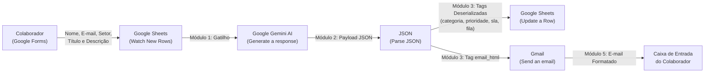
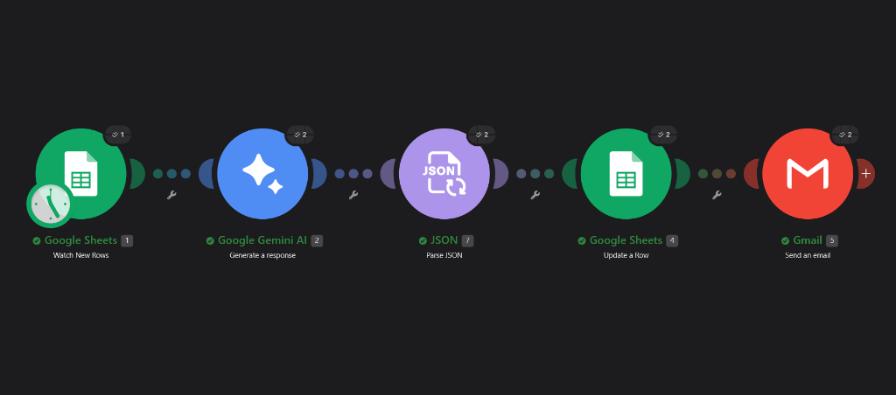
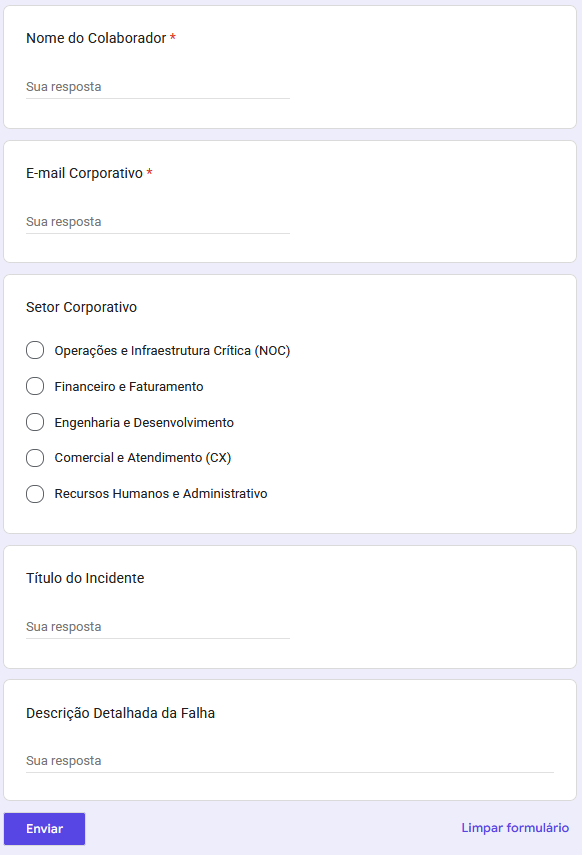
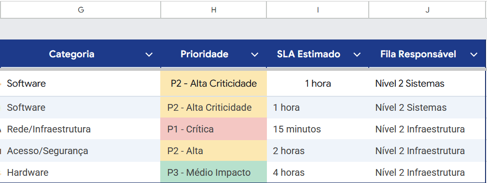
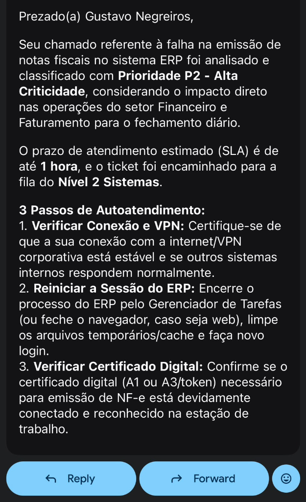

# HelpDesk AI: Triagem Inteligente e Autoatendimento de Chamados por Setor Corporativo

> **Projeto Acadêmico em Grupo — Paradigmas No Code, Low Code e Vibecode**  
> **Instituição:** Centro Universitário do Distrito Federal (UDF)  
> **Disciplina:** Tendências em Ciência da Computação  
> **Docente:** Profa. Kadidja Valéria  
> **Integrantes:** Gustavo Negreiros e João Pedro Alves  

---

### Links de Acesso Rápido ao Protótipo

| Recurso Oficial | Link de Acesso Direto | Finalidade no Projeto |
| :--- | :--- | :--- |
| **Formulário de Abertura de Chamados** | [Google Forms — NexusTech S.A.](https://docs.google.com/forms/d/e/1FAIpQLScvJ9kLyNEA24scTzgwMxT70fgD8yKDRmFDDphdJrqPS7DXJA/viewform?usp=publish-editor) | Portal No Code para abertura de chamados com seleção dos 5 setores |
| **Planilha de Governança e Triagem** | [Google Sheets — Fila de Tickets](https://docs.google.com/spreadsheets/d/1wQwLty4UdgL0f-Vay306g_o7PP_l3d6vIycTtGo4vec/edit?usp=sharing) | Base central de dados com classificação da IA e formatação condicional |
| **Apresentação Executiva (PDF 16:9)** | [Baixar Apresentacao_HelpDesk_AI.pdf](slides/Apresentacao_HelpDesk_AI.pdf) | Slides no padrão editorial técnico para apresentação e avaliação |
| **Apresentação Interativa (HTML)** | [slides/pitch_deck.html](slides/pitch_deck.html) | Deck interativo 100% offline para navegação direta no navegador |

---

## Sumário
- [1. Cenário Corporativo e Descrição do Desafio](#1-cenário-corporativo-e-descrição-do-desafio)
- [2. Estrutura Organizacional e Matriz de Criticidade por Setor](#2-estrutura-organizacional-e-matriz-de-criticidade-por-setor)
- [3. Justificativa das Tecnologias e Paradigmas](#3-justificativa-das-tecnologias-e-paradigmas)
- [4. Arquitetura da Solução e Fluxo de Dados](#4-arquitetura-da-solução-e-fluxo-de-dados)
- [5. Evidências do Protótipo Funcional](#5-evidências-do-protótipo-funcional)
- [6. Reflexão Crítica: Vantagens e Limitações](#6-reflexão-crítica-vantagens-e-limitações)
- [7. Organização e Divisão de Responsabilidades](#7-organização-e-divisão-de-responsabilidades)
- [8. Apresentação em Slides e Recursos do Projeto](#8-apresentação-em-slides-e-recursos-do-projeto)

---

## 1. Cenário Corporativo e Descrição do Desafio

### A Empresa Hipotética: NexusTech S.A.
Para contextualizar a aplicação em um ambiente real de Engenharia de Software e Gestão de Serviços de TI (ITSM), o protótipo foi projetado para a **NexusTech S.A.**, uma empresa de tecnologia financeira e logística que opera com cinco departamentos distintos, cada um possuindo diferentes níveis de tolerância a falhas e Acordos de Nível de Serviço (SLAs).

### O Desafio
No modelo tradicional de Help Desk da NexusTech S.A., todos os chamados caíam em uma fila única e linear. Isso gerava três falhas operacionais graves:
1. **Ausência de Contexto Organizacional:** Uma falha de impressora no RH aguardava na mesma fila linear que uma queda de faturamento no Financeiro ou uma parada no cluster de Operações Críticas.
2. **Tempo Elevado de Primeira Resposta (First Response Time):** Analistas de suporte Nível 1 gastavam grande parte do expediente lendo tickets, identificando manualmente a área e respondendo dúvidas recorrentes.
3. **Subjetividade na Priorização:** Solicitações abertas pelos próprios usuários frequentemente recebiam marcação de urgência máxima sem embasamento técnico, distorcendo os SLAs.

### A Solução: HelpDesk AI Contextual
O **HelpDesk AI** é um sistema automatizado orientado a eventos que realiza a triagem cognitiva dos chamados da NexusTech S.A. A solução cruza o **relato técnico do incidente** com o **setor corporativo do solicitante**, utilizando Inteligência Artificial Generativa para:
* Classificar a categoria técnica da falha (Hardware, Software, Rede/Infraestrutura ou Acesso/Segurança).
* Calcular dinamicamente a prioridade real (P1 a P4) e o SLA de atendimento com base no impacto de negócio do setor.
* Definir a fila de escalonamento responsável (Nível 1, Nível 2 Infraestrutura ou Nível 2 Sistemas).
* Enviar imediatamente um e-mail com guia técnico de autoatendimento em 3 passos seguros para o colaborador.

---

## 2. Estrutura Organizacional e Matriz de Criticidade por Setor

A lógica do sistema considera os 5 setores da **NexusTech S.A.** para ponderação de impacto pela Inteligência Artificial:

| Setor da Empresa | Impacto de Negócio | Exemplos de Incidentes Críticos | Peso na Priorização (SLA Base) |
| :--- | :--- | :--- | :--- |
| **1. Operações e Infraestrutura Crítica (NOC)** | Altíssimo (afeta disponibilidade de serviços aos clientes finais) | Queda de servidores, falha em links dedicados, indisponibilidade de banco de dados | Prioridade Elevada (P1 / P2) — SLA de 15 min a 1h |
| **2. Financeiro e Faturamento** | Alto (impacta fluxo de caixa, emissão de notas fiscais e conciliação bancária) | Travamento de ERP, erro em certificado digital, bloqueio em gateway de pagamento | Prioridade Alta (P1 / P2) — SLA de 30 min a 2h |
| **3. Engenharia e Desenvolvimento** | Médio/Alto (paralisa esteiras de desenvolvimento e deploy) | Falha em pipelines CI/CD, bloqueio de chaves SSH/Git, queda de ambiente de homologação | Prioridade Média/Alta (P2 / P3) — SLA de 1h a 4h |
| **4. Comercial e Atendimento (CX)** | Médio (impacta prospecção de vendas e suporte ao cliente externo) | Indisponibilidade de CRM, falha em headset/telefonia VoIP, lentidão de navegador | Prioridade Média (P2 / P3) — SLA de 2h a 6h |
| **5. Recursos Humanos e Administrativo** | Baixo/Moderado (operações internas sem impacto imediato no cliente externo) | Impressora offline, criação de conta para novo colaborador, configuração de pacote Office | Prioridade Padrão (P3 / P4) — SLA de 4h a 24h |

---

## 3. Justificativa das Tecnologias e Paradigmas

| Paradigma | Ferramenta Adotada | Papel no Sistema | Justificativa Técnica |
| :--- | :--- | :--- | :--- |
| **No Code** | **Google Forms** e **Google Sheets** | Portal de abertura de chamados por setor e banco de dados de governança | Permite criar campos de seleção fechada de setor, validação de e-mail e persistência estruturada em nuvem com custo zero e sem codificação de backend/SQL. |
| **Low Code** | **Make (Integromat)** | Orquestrador lógico, roteador condicional e integrador de APIs | Superou o Zapier por permitir cenários multi-etapas gratuitos (1.000 ops/mês). Conecta gatilhos, gerencia autenticação OAuth2 e deserializa JSON nativamente. |
| **Vibecode / IA** | **Gemini Flash (LLM)** via API | Motor de inferência contextual e geração de autoatendimento | Substitui dezenas de regras condicionais `if/else` por inferência semântica que cruza o relato leigo com as regras de negócio da NexusTech e retorna JSON estruturado. |
| **Canal de Entrega** | **Gmail (Google Workspace)** | Despacho de orientações e notificações de SLA | Entrega na caixa de entrada do solicitante o protocolo, a prioridade, o SLA calculado e 3 passos seguros de autoatendimento em formato HTML limpo. |

---

## 4. Arquitetura da Solução e Fluxo de Dados

O diagrama abaixo ilustra o pipeline com os **5 módulos operacionais** do HelpDesk AI:

### Etapas do Processamento:
1. **Submissão Contextualizada:** O colaborador acessa o formulário da NexusTech S.A., seleciona seu **Setor Corporativo** em uma lista suspensa fechada e relata a falha.
2. **Gatilho de Captura:** O módulo 1 do Make (`Google Sheets: Watch New Rows`) detecta a nova submissão e extrai as variáveis de entrada.
3. **Inferência Cognitiva (Vibecode):** O módulo 2 (`Google Gemini AI: Generate a response`) aplica as regras da matriz de criticidade e gera a saída estruturada em JSON estrito.
4. **Deserialização Estruturada:** O módulo 3 (`JSON: Parse JSON`) decodifica o payload do modelo em variáveis independentes (`categoria`, `prioridade`, `sla`, `fila` e `email_html`).
5. **Governança em Banco de Dados:** O módulo 4 (`Google Sheets: Update a Row`) grava cada dado em sua coluna correspondente na planilha central da TI.
6. **Entrega de Autoatendimento:** O módulo 5 (`Gmail: Send an email`) despacha o e-mail em formato HTML ao colaborador com a prioridade, SLA e 3 passos práticos de primeiro nível.

---

## 5. Evidências do Protótipo Funcional

* **Formulário de Abertura de Chamados — Google Forms (No Code):**  
  [Acessar Formulário de Suporte — NexusTech S.A.](https://docs.google.com/forms/d/e/1FAIpQLScvJ9kLyNEA24scTzgwMxT70fgD8yKDRmFDDphdJrqPS7DXJA/viewform?usp=publish-editor)  
  `https://docs.google.com/forms/d/e/1FAIpQLScvJ9kLyNEA24scTzgwMxT70fgD8yKDRmFDDphdJrqPS7DXJA/viewform?usp=publish-editor`

* **Planilha de Governança e Triagem — Google Sheets (Database):**  
  [Acessar Planilha de Chamados — NexusTech S.A.](https://docs.google.com/spreadsheets/d/1wQwLty4UdgL0f-Vay306g_o7PP_l3d6vIycTtGo4vec/edit?usp=sharing)  
  `https://docs.google.com/spreadsheets/d/1wQwLty4UdgL0f-Vay306g_o7PP_l3d6vIycTtGo4vec/edit?usp=sharing`

### Galeria de Capturas de Tela do Protótipo Operacional:

#### 1. Orquestração Completa no Make.com (5 Módulos com Execução Confirmada)

#### 2. Portal de Entrada de Chamados (Google Forms com Seleção Fechada de Setores)

#### 3. Planilha de Governança com Triagem Automática e Formatação Condicional

#### 4. E-mail de Autoatendimento Entregue ao Usuário no Gmail (Dark Mode com 3 Passos)

---

## 6. Reflexão Crítica: Vantagens e Limitações

### 3 Vantagens Comprovadas
1. **Priorização Inteligente Sensível ao Negócio (Business-Aware Triage):**  
   Elimina a subjetividade do usuário ao cruzar o impacto financeiro/operacional do setor solicitante com o sintoma técnico relatado, garantindo atendimento prioritário para áreas críticas da NexusTech S.A.
2. **Redução Drástica do Tempo de Resposta em Nível 1:**  
   Entrega instruções claras de autoatendimento em menos de 30 segundos após o envio do formulário, permitindo que falhas simples sejam resolvidas pelo próprio usuário antes da intervenção humana.
3. **Custo de Infraestrutura Zero e Agilidade de MVP:**  
   O sistema completo foi projetado e colocado em operação utilizando exclusivamente planos gratuitos em nuvem (Google Forms, Google Sheets, Make e Gemini API), reduzindo semanas de desenvolvimento de backend a poucas horas de configuração visual.

### 3 Limitações Técnicas Enfrentadas
1. **Risco de Diagnóstico Genérico em Relatos Curtos:**  
   Se o usuário fornecer descrições excessivamente vagas (ex.: "computador travou"), o modelo de linguagem pode sugerir passos genéricos. Para mitigar esse risco, o System Prompt inclui cláusula de contingência que rebaixa o ticket para P3 e solicita informações adicionais sem executar ações invasivas.
2. **Cotas Mensais e Disponibilidade de API (HTTP 503):**  
   O plano gratuito do Make impõe limite de 1.000 operações mensais. Além disso, durante os testes da disciplina, a API gratuita do Gemini apresentou intermitência temporária com erro `HTTP 503 (High Demand)`, exigindo contingência operacional que em ambiente de produção demanda contratos corporativos com SLA garantido.
3. **Privacidade de Dados e Conformidade (LGPD):**  
   Os dados dos chamados trafegam por provedores de nuvem pública. Em um cenário corporativo definitivo na NexusTech S.A., é obrigatório implementar filtros de anonimização prévia (Data Masking) para impedir o tráfego de dados pessoais e segredos industriais em instâncias públicas de IA.

---

## 7. Organização e Divisão de Responsabilidades

Em conformidade com as diretrizes da disciplina para trabalho colaborativo em equipe:

| Integrante | Frentes de Atuação | Entregas Realizadas no Projeto |
| :--- | :--- | :--- |
| **Gustavo Negreiros** | Modelagem Organizacional, No Code & Vibecode | Definição da empresa NexusTech S.A. e dos 5 setores; criação do Google Forms com campos fechados; estruturação da planilha de governança no Sheets; elaboração do prompt de triagem contextual e System Instructions do Gemini com schema JSON. |
| **João Pedro Alves** | Orquestração Low Code, Integração & Qualidade | Configuração do cenário no Make.com com os 5 nós operacionais; parametrização da deserialização no módulo Parse JSON; integração OAuth2 com Gmail; execução dos casos de teste (P1, P2 e P3) e estruturação dos slides executivos. |

---

## 8. Apresentação em Slides e Recursos do Projeto

* **Apresentação Executiva em PDF (Widescreen 16:9):**  
  [Visualizar / Baixar Apresentacao_HelpDesk_AI.pdf](slides/Apresentacao_HelpDesk_AI.pdf)  
  *12 slides com design editorial técnico em dark mode, tipografia de alto contraste para projetor e diagramas arquiteturais.*

* **Apresentação Interativa em HTML/CSS (100% Offline):**  
  [`slides/pitch_deck.html`](slides/pitch_deck.html)  
  *Versão executável em qualquer navegador com imagens embutidas em Base64, atalhos de navegação (setas, tecla G para índice, tecla F para tela cheia e tecla E para edição ao vivo).*

* **Versão Acadêmica em LaTeX (Beamer):**  
  [`slides/main.tex`](slides/main.tex)  
  *Código-fonte em LaTeX estruturado para compilação direta no Overleaf.*

* **Registro das Etapas de Desenvolvimento (Checklist da Disciplina):**  
  [`docs/etapas_desenvolvimento.md`](docs/etapas_desenvolvimento.md)  
  *Memorial descritivo detalhando o cumprimento dos 24 itens do checklist da Profa. Kadidja Valéria ao longo das semanas de projeto.*
