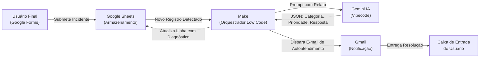

# HelpDesk AI: Triagem Inteligente e Autoatendimento de Chamados de TI

> **Projeto Acadêmico Individual — Paradigmas No Code, Low Code e Vibecode**  
> **Instituição:** Centro Universitário do Distrito Federal (UDF)  
> **Disciplina:** Tendências em Ciência da Computação  
> **Docente:** Profa. Kadidja Valéria  
> **Autor:** Gustavo Negreiros  

---

## Sumário
- [1. Visão Geral e Descrição do Desafio](#1-visão-geral-e-descrição-do-desafio)
- [2. Justificativa das Tecnologias e Paradigmas](#2-justificativa-das-tecnologias-e-paradigmas)
- [3. Arquitetura da Solução e Fluxo de Dados](#3-arquitetura-da-solução-e-fluxo-de-dados)
- [4. Evidências do Protótipo Funcional](#4-evidências-do-protótipo-funcional)
- [5. Reflexão Crítica: Vantagens e Limitações](#5-reflexão-crítica-vantagens-e-limitações)
- [6. Organização do Trabalho Individual](#6-organização-do-trabalho-individual)
- [7. Apresentação e Recursos Adicionais](#7-apresentação-e-recursos-adicionais)

---

## 1. Visão Geral e Descrição do Desafio

### O Desafio
Em ambientes corporativos e educacionais, os departamentos de Suporte e Tecnologia da Informação (Help Desk / Service Desk) enfrentam constantemente sobrecarga operacional decorrente do alto volume de chamados de baixa complexidade (como redefinição de credenciais, dúvidas de conectividade local e configurações básicas de software). 

O processo tradicional de triagem manual apresenta gargalos crônicos:
* **Tempo elevado de primeira resposta (First Response Time):** O usuário aguarda horas para receber instruções simples que poderiam ser resolvidas de forma autônoma.
* **Erros de priorização:** Usuários tendem a classificar qualquer incidente como de urgência crítica, distorcendo a fila técnica de atendimento.
* **Custo e lentidão de desenvolvimento:** Criar um sistema corporativo completo de ITSM (Information Technology Service Management) com backend tradicional exige infraestrutura dedicada, semanas de desenvolvimento e manutenção contínua.

### A Solução: HelpDesk AI
O **HelpDesk AI** é um protótipo funcional orientado a eventos que automatiza a triagem primária de incidentes técnicos. O sistema coleta o relato do incidente, utiliza Inteligência Artificial Generativa para categorizar a falha (Hardware, Software, Redes ou Acesso), atribui uma prioridade técnica padronizada (P1 a P4) e redige uma resposta imediata de autoatendimento contendo passos práticos para resolução pelo próprio usuário.

---

## 2. Justificativa das Tecnologias e Paradigmas

A solução foi estruturada para demonstrar na prática a convergência entre os três paradigmas abordados na disciplina:

| Paradigma | Ferramenta Adotada | Papel no Sistema | Justificativa Técnica |
| :--- | :--- | :--- | :--- |
| **No Code** | **Google Forms** e **Google Sheets** | Interface de abertura de chamado e base de dados persistente | Elimina a necessidade de codificar telas de login, formulários HTML e bancos relacionais. Oferece interface responsiva e armazenamento tabular estruturado. |
| **Low Code** | **Make (Integromat)** | Orquestrador de integração e lógica de negócio | Centraliza a escuta de novos registros, manipulação de payloads JSON, invocação de APIs de IA e atualização de status sem necessidade de servidor backend. |
| **Vibecode / IA** | **Gemini (LLM)** via API | Processamento de linguagem natural e autoatendimento | Uso de engenharia de prompts iterativa para interpretar textos não estruturados, classificar o chamado em taxonomia técnica e gerar orientações contextuais. |
| **Canal de Entrega** | **Gmail (Google Workspace)** | Notificação e entrega ao usuário | Canal nativo, confiável e com alta entregabilidade para envio das instruções técnicas ao solicitante. |

---

## 3. Arquitetura da Solução e Fluxo de Dados

O ciclo de vida de um incidente no **HelpDesk AI** segue uma arquitetura orientada a eventos (event-driven architecture):

### Passo a Passo da Execução:
1. **Abertura do Chamado:** O solicitante preenche o formulário informando seu Nome, E-mail, Título do Problema e Descrição detalhada do incidente.
2. **Registro de Dados:** A entrada é persistida imediatamente como uma nova linha na planilha do Google Sheets.
3. **Disparo da Automação:** O Make identifica a nova ocorrência e inicia o cenário de triagem.
4. **Interpretação e Vibecoding:** O Make envia o relato para o modelo Gemini através de um prompt instrucional rigoroso. A IA extrai:
   * **Categoria:** Classificação do problema (Ex.: Redes, Acesso/Contas, Software, Hardware).
   * **Prioridade Técnica:** P1 (Crítica), P2 (Alta), P3 (Média) ou P4 (Baixa).
   * **Instruções de Autoatendimento:** Procedimentos em tópicos para o usuário tentar sanar o problema imediatamente.
5. **Enriquecimento da Base:** O Make grava a categoria e a prioridade atribuídas pela IA de volta na planilha para acompanhamento da equipe técnica.
6. **Entrega da Orientação:** O conector do Gmail encaminha ao usuário um e-mail com o número do chamado, classificação e guia de solução rápida.

---

## 4. Evidências do Protótipo Funcional

* **Formulário de Abertura de Chamados (No Code):**  
  [Acessar Formulário de Suporte](https://forms.google.com) *(Inserir link do formulário criado)*

* **Planilha de Gestão e Triagem Técnica (Database):**  
  [Acessar Planilha de Chamados](https://sheets.google.com) *(Inserir link da planilha criada)*

* **Cenário de Automação no Make:**  
  *(Inserir captura de tela do cenário em `docs/images/make_flow.png`)*

* **Exemplo de E-mail de Autoatendimento Gerado por IA:**  
  *(Inserir captura de tela do e-mail recebido em `docs/images/email_sample.png`)*

---

## 5. Reflexão Crítica: Vantagens e Limitações

### Vantagens da Abordagem Adotada
1. **Redução Substancial do Tempo de Resposta (SLA Primário):**  
   O usuário recebe uma primeira orientação técnica estruturada em segundos após o envio do chamado, permitindo a resolução autônoma de dúvidas frequentes sem onerar a equipe técnica humana.
2. **Time-to-Market e Custo Operacional Nulo:**  
   O sistema foi idealizado, configurado, integrado e homologado em poucas horas de trabalho, utilizando exclusivamente recursos das camadas gratuitas (free tiers) de serviços consolidados, dispensando infraestrutura de servidores e pipelines complexos de CI/CD.
3. **Flexibilidade Cognitiva via Vibecode:**  
   Ao contrário de regras tradicionais baseadas em palavras-chave rígidas (if/else), a IA compreende variações linguísticas, jargões populares e relatos imprecisos de usuários leigos, interpretando o contexto semântico real da falha.

### Limitações Enfrentadas
1. **Risco de Alucinação em Diagnósticos Críticos:**  
   Modelos de linguagem generativa podem sugerir passos inadequados ou inventar comandos técnicos se não houver um sistema rígido de restrição de prompt (*guardrails*). Por isso, o sistema é classificado estritamente como triagem de primeiro nível, não substituindo o diagnóstico humano definitivo.
2. **Latência de Polling e Quotas em Ambientes Gratuitos:**  
   No plano gratuito do Make, a verificação da planilha opera por consulta periódica (polling a cada 15 minutos), a menos que seja configurado um webhook instantâneo. Além disso, existe o teto mensal de 1.000 operações.
3. **Restrições de Governança e Privacidade de Dados Corporativos:**  
   Dados de incidentes internos trafegam por provedores externos de nuvem (Google e Make). Para uso em ambientes corporativos sensíveis com conformidade à LGPD/GDPR, seria necessário utilizar instâncias privadas ou modelos de linguagem hospedados internamente.

---

## 6. Organização do Trabalho Individual

Em atendimento à definição de escopo individual, todas as etapas do ciclo de engenharia de software foram executadas por um único autor:

| Etapa do Projeto | Responsabilidade | Atividades Executadas |
| :--- | :--- | :--- |
| **Modelagem de Dados e UX** | Gustavo Negreiros | Elaboração do formulário no Google Forms e parametrização das colunas de controle na planilha do Google Sheets. |
| **Arquitetura de Automação** | Gustavo Negreiros | Construção lógica do fluxo no Make, tratamento de variáveis de payload e integração entre APIs. |
| **Engenharia de Prompts (Vibecode)** | Gustavo Negreiros | Modelagem e refinamento iterativo dos prompts de classificação, priorização e síntese técnica no Gemini. |
| **Documentação Técnica e Apresentação** | Gustavo Negreiros | Validação do fluxo ponta a ponta, elaboração da documentação técnica e estruturação dos slides acadêmicos em LaTeX Beamer. |

---

## 7. Apresentação e Recursos Adicionais

* **Slides em LaTeX (Beamer):** O arquivo-fonte da apresentação encontra-se em [`slides/main.tex`](slides/main.tex), estruturado e compatível com compilação direta no Overleaf.
* **Proposta da Apresentação:** Explanação sintética dos objetivos, demonstração do fluxo operacional, reflexão crítica sobre a maturidade da tecnologia e perspectivas de evolução (como integração direta com Jira Service Management e canais de chat como Slack/Discord).
