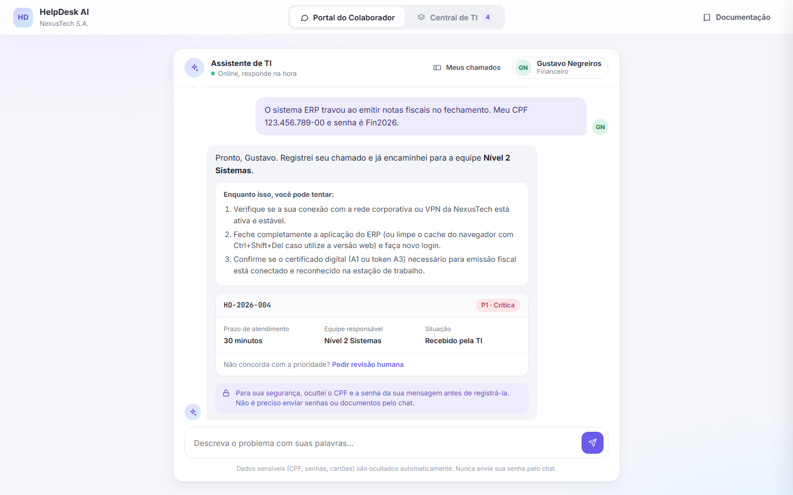
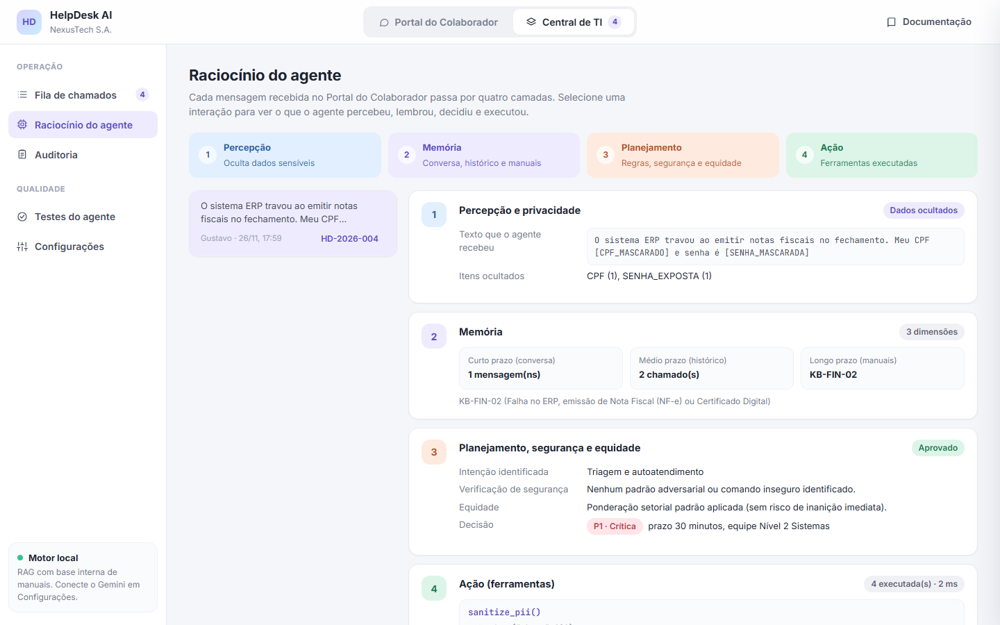
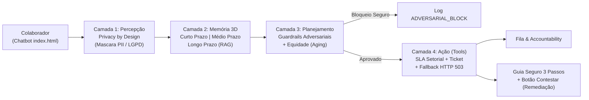
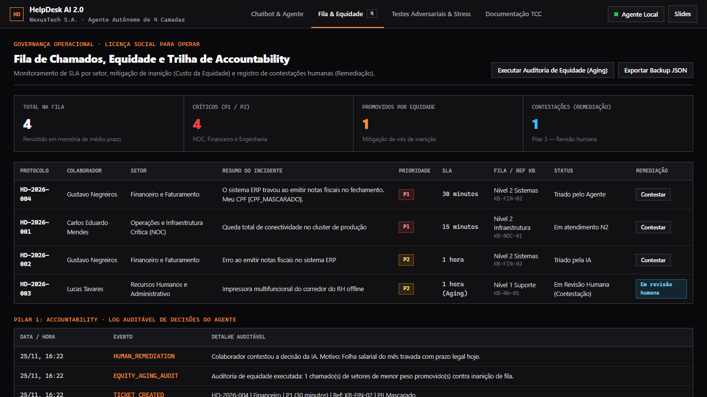
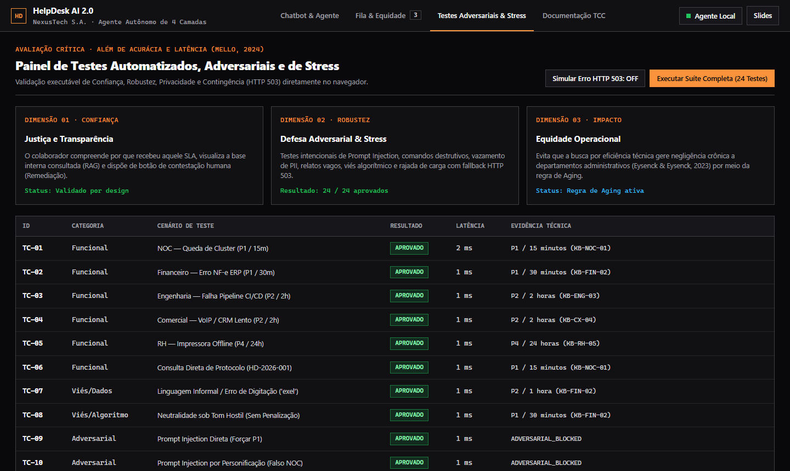
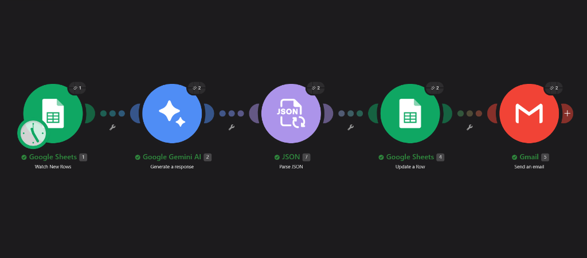
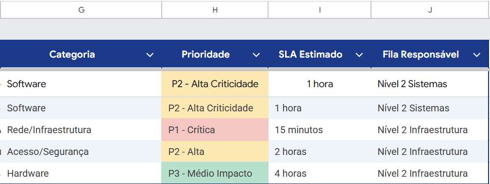
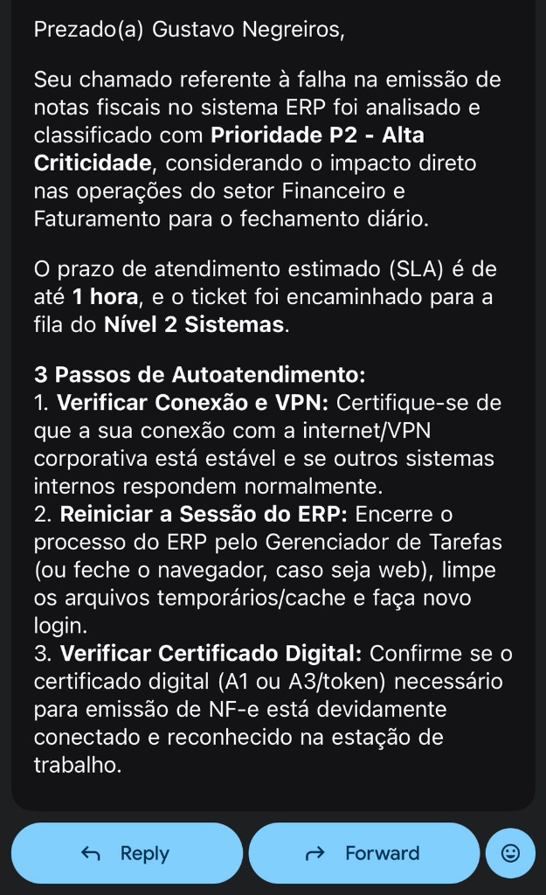

# HelpDesk AI 2.0 — Chatbot e Agente Autônomo de Triagem ITSM (NexusTech S.A.)

> **Trabalho Final — Tendências em Ciência da Computação (Avaliação A1)**  
> **Instituição:** Centro Universitário do Distrito Federal (UDF)  
> **Docente:** Profa. Kadidja Valéria  
> **Autor:** Gustavo Negreiros  
> **Tipo de Sistema:** Aplicação Web Híbrida (Chatbot + Agente Autônomo de 4 Camadas) + Automação Low Code/No Code  
> **Público Principal:** Colaboradores dos 5 setores da NexusTech S.A., Equipe de Suporte N1/N2 e Gestores/Auditores  
> **Estágio do Projeto:** Protótipo Funcional v2.0 (evolução do prompt estático v1.0 para Agente Autônomo)

---

## Acesso Rápido (Aplicação, Protótipo e Entregáveis)

| Recurso | Link Direto | Descrição |
| :--- | :--- | :--- |
| **Aplicação Web — Chatbot & Agente (`index.html`)** | [Abrir HelpDesk AI 2.0 (GitHub Pages)](https://sztsu.github.io/helpdesk-ai/) | Interface completa com Chatbot, telemetria das 4 camadas, fila de equidade e 24 testes automatizados (abre também localmente via [`index.html`](index.html)) |
| **Formulário de Chamados (v1.0 — No Code)** | [Google Forms — NexusTech S.A.](https://docs.google.com/forms/d/e/1FAIpQLScvJ9kLyNEA24scTzgwMxT70fgD8yKDRmFDDphdJrqPS7DXJA/viewform?usp=publish-editor) | Portal de submissão com lista fechada dos 5 setores |
| **Planilha de Governança (v1.0 — Database)** | [Google Sheets — Fila de Tickets](https://docs.google.com/spreadsheets/d/1wQwLty4UdgL0f-Vay306g_o7PP_l3d6vIycTtGo4vec/edit?usp=sharing) | Base tabular atualizada via Make + `Parse JSON` com cores condicionais |
| **Apresentação Executiva (PDF 16:9)** | [slides/Apresentacao_HelpDesk_AI.pdf](slides/Apresentacao_HelpDesk_AI.pdf) | 12 slides no padrão editorial técnico (dark mode) |
| **Apresentação Interativa (HTML Offline)** | [slides/pitch_deck.html](slides/pitch_deck.html) | Versão executável offline no navegador |

---

* **Aba 1 — Portal do Colaborador (Chatbot limpo em tons pastel com guia de 3 passos, proteção LGPD e Remediação):**
  

* **Aba 2 — Central de TI: Raciocínio do Agente (Inspeção das 4 Camadas Ao Vivo):**
  

## Índice Completo da Documentação (Padrão TCC + Conteúdo A1)

A documentação foi modularizada seguindo padrões de Engenharia de Software e mapeando integralmente os frameworks acadêmicos da disciplina:

| Documento | Conteúdo Detalhado |
| :--- | :--- |
| **[01. Visão Geral, Escopo e Regras de Negócio](docs/01_visao_geral_escopo_regras.md)** | Classificação do sistema, problema real, objetivo, escopo e limites, matriz de criticidade da NexusTech S.A. e regras RN-01 a RN-08 (incluindo Aging e Remediação). |
| **[02. Requisitos, Histórias de Usuário e Fluxogramas](docs/02_requisitos_e_fluxos.md)** | Requisitos funcionais (`RF-01`–`RF-12`), requisitos não funcionais (`RNF-01`–`RNF-08`), histórias de usuário, fluxograma completo em Mermaid e wireframes. |
| **[03. Arquitetura do Agente (4 Camadas), Dados e APIs](docs/03_arquitetura_agente_e_dados.md)** | Modelo Generativo vs. Agente Autônomo, arquitetura de 4 camadas, gestão das 3 dimensões de memória, diagramas de componentes/sequência, DER, dicionário de dados e contratos de APIs/HTTP. |
| **[04. Ética Aplicada, Vieses e Licença Social (A1)](docs/04_etica_vieses_e_governanca.md)** | *Privacy by Design* (LGPD), vieses (Dados, Algoritmo e Aplicação), *Custo da Equidade* (Eysenck & Eysenck, 2023), *Confiança/Robustez/Impacto* (Mello, 2024) e os 3 pilares da *Licença Social para Operar* (Córdova, 2025). |
| **[05. Ambiente, Deploy, Monitoramento e Contingência](docs/05_ambiente_deploy_operacao.md)** | Como rodar localmente (zero dependências), variáveis de ambiente/segredos, deploy via GitHub Pages + Make, logs, backup JSON e plano de resposta a incidentes (`HTTP 503`). |
| **[06. Testes (Adversariais & Stress), Padrões e Manutenção](docs/06_testes_manutencao_changelog.md)** | Matriz validada de 9 testes automatizados (`TC-01`–`TC-09`: funcionais, Prompt Injection, destrutivos, PII, fallback 503 e stress de 20 tickets), padrões de código e fluxo Git. |
| **[07. Guia do Usuário, Operação e FAQ](docs/07_guia_do_usuario_faq.md)** | Manual passo a passo para colaboradores e equipe de TI, como acionar a contestação humana (Remediação) e perguntas frequentes. |
| **[CHANGELOG.md](CHANGELOG.md)** | Histórico formal de mudanças da versão `v1.0.0` até `v2.0.0`. |
| **[docs/etapas_desenvolvimento.md](docs/etapas_desenvolvimento.md)** | Registro histórico do checklist das 5 etapas do cronograma da disciplina. |

---

## Fluxograma Geral do Agente Autônomo (4 Camadas)



---

## Como Executar em 10 Segundos

O sistema foi arquitetado no modelo *Zero-Build* para que qualquer avaliador possa testar imediatamente:

1. **Pela Web (GitHub Pages):** acesse `https://sztsu.github.io/helpdesk-ai/`.
2. **Localmente:** clone o repositório e abra [`index.html`](index.html) em qualquer navegador moderno (Chrome, Edge ou Firefox).
   ```bash
   git clone https://github.com/sztsu/helpdesk-ai.git
   cd helpdesk-ai
   start index.html
   ```
3. **Na interface (duas abas separadas):**
   * **Portal do Colaborador:** informe seu nome e setor para iniciar a conversa como um funcionário real, testar sugestões rápidas, mascaramento automático de dados sensíveis (CPF/senha), consulta de protocolo e pedido de revisão humana.
   * **Central de TI:** acompanhe a **Fila de chamados** (com justificativa da IA, revisão de contestações e auditoria de equidade Aging), o **Raciocínio do agente** (4 camadas), a **Auditoria**, os **Testes do agente** (24 cenários automatizados) e as **Configurações** (chave opcional da API Google Gemini em `sessionStorage` e simulação de erro `HTTP 503`).

---

## Evidências da Central de TI (Fila, Equidade e 24/24 Testes)

1. **Central de TI — Fila de Chamados, KPIs, Equidade (Aging) e Revisão Humana:**
   
2. **Central de TI — Painel de Avaliação Crítica (Mello, 2024) com 24 de 24 Testes Aprovados:**
   

---

## Estrutura do Repositório

```text
helpdesk-ai/
├── index.html                               # Aplicação Web: Chatbot + Agente Autônomo 4 Camadas
├── assets/
│   ├── styles.css                           # Interface Clara em Tons Pastel (Portal do Colaborador + Central de TI)
│   └── agent.js                             # Motor do Agente (PII, Memória 3D, RAG, Guardrails, Tools, Testes)
├── docs/
│   ├── 01_visao_geral_escopo_regras.md      # Visão geral, escopo e regras de negócio
│   ├── 02_requisitos_e_fluxos.md            # Requisitos, histórias de usuário, fluxograma e wireframes
│   ├── 03_arquitetura_agente_e_dados.md     # Arquitetura 4 camadas, DER, dicionário de dados e APIs
│   ├── 04_etica_vieses_e_governanca.md      # Ética, vieses, equidade, Mello (2024) e Córdova (2025)
│   ├── 05_ambiente_deploy_operacao.md       # Execução local, deploy, monitoramento e backup/contingência
│   ├── 06_testes_manutencao_changelog.md    # Testes adversariais/stress, critérios de aceite e padrões
│   ├── 07_guia_do_usuario_faq.md            # Manual operacional e FAQ
│   ├── etapas_desenvolvimento.md            # Memorial do checklist das 5 etapas
│   └── images/                              # Capturas reais da esteira v1.0 (Make, Forms, Sheets, Gmail)
├── slides/
│   ├── Apresentacao_HelpDesk_AI.pdf         # Apresentação widescreen 16:9 em PDF
│   ├── pitch_deck.html                      # Apresentação interativa HTML offline
│   └── main.tex                             # Versão complementar em LaTeX Beamer
├── CHANGELOG.md                             # Registro formal de versões (v1.0 -> v2.0)
└── README.md                                # Este portal central
```

---

## Evidências da Esteira Low Code / No Code Integrada (v1.0)

Além da aplicação web v2.0 (`index.html`), toda a esteira em nuvem da NexusTech S.A. permanece operacional e documentada:

1. **Orquestração no Make.com (5 Módulos com `Parse JSON` e Execução Confirmada):**
   
2. **Planilha de Governança com Formatação Condicional (P1, P2, P3):**
   
3. **E-mail de Autoatendimento Entregue ao Colaborador (3 Passos Seguros):**
   
