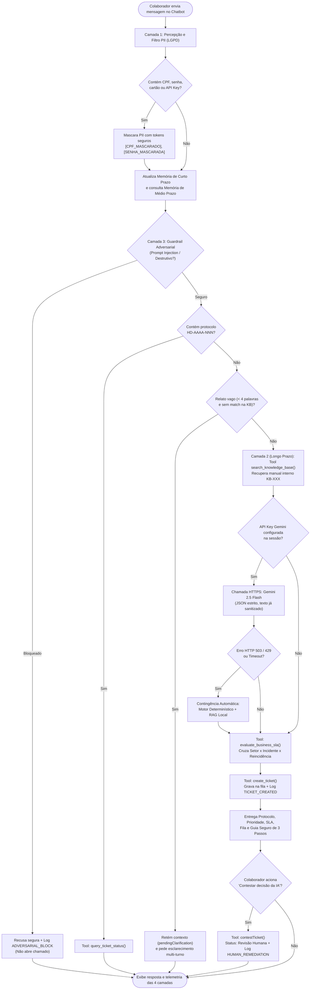

# 02. Requisitos, Histórias de Usuário, Fluxogramas e Protótipos

> **Sistema:** HelpDesk AI 2.0 — NexusTech S.A.  
> **Referência Técnica:** Especificação funcional, não funcional e fluxos de interação.

---

## 1. Requisitos Funcionais (RF)

| ID | Requisito Funcional | Entrada | Saída Esperada |
| :--- | :--- | :--- | :--- |
| **RF-01** | **Atendimento Conversacional via Chatbot** | Mensagem em linguagem natural, nome do colaborador e setor corporativo selecionado. | Resposta contextual estruturada no chat com protocolo, classificação e orientações. |
| **RF-02** | **Sanitização Automática de PII (LGPD)** | Texto bruto digitado no chat contendo dados sensíveis (CPF, senha, cartão, API Key, e-mail pessoal). | Texto sanitizado com marcadores seguros e alerta visual de privacidade na tela e na Camada 1. |
| **RF-03** | **Esclarecimento Multi-Turno para Relatos Vagos** | Mensagem curta e sem contexto técnico (menos de 4 palavras e sem match na KB). | Pergunta de esclarecimento sem abrir chamado; retenção do turno anterior na Memória de Curto Prazo. |
| **RF-04** | **Recuperação de Manuais Internos (RAG)** | Texto sanitizado + setor corporativo. | Identificação do manual interno mais aderente (`KB-NOC-01` a `KB-SEC-06`) e seus 3 passos seguros. |
| **RF-05** | **Cálculo Dinâmico de Prioridade, SLA e Fila** | Setor, artigo RAG recuperado, severidade textual e histórico de reincidência. | Atribuição de Categoria, Prioridade (`P1`–`P4`), prazo de SLA e fila (`N1`/`N2`). |
| **RF-06** | **Detecção e Bloqueio Adversarial** | Tentativas de *Prompt Injection* ou pedidos de comandos destrutivos/senhas. | Bloqueio preventivo sem abertura de ticket, aviso de segurança e evento `ADVERSARIAL_BLOCK` no log. |
| **RF-07** | **Consulta de Protocolo via Chat** | Mensagem contendo código de protocolo no padrão `HD-AAAA-NNN`. | Retorno imediato com status atual, prioridade, SLA e fila do chamado localizado. |
| **RF-08** | **Telemetria Ao Vivo das 4 Camadas do Agente** | Cada execução do pipeline `processMessage()`. | Atualização em tempo real do painel lateral exibindo Percepção, Memória 3D, Planejamento e Tools JSON. |
| **RF-09** | **Gestão de Fila, Equidade (Aging) e Backup** | Ações do gestor na aba *Fila & Equidade*. | Visualização tabular com KPIs, promoção de tickets antigos por equidade e download de backup JSON. |
| **RF-10** | **Contestação Humana (Remediação)** | Clique em "Contestar decisão da IA" + justificativa do colaborador. | Alteração do status para `Em Revisão Humana (Contestação)` e registro `HUMAN_REMEDIATION` na auditoria. |
| **RF-11** | **Direito ao Esquecimento (Limpar Memória)** | Clique no botão "Limpar Memória (LGPD)". | Limpeza da memória de curto e médio prazo no navegador (`localStorage`) com reinício limpo da sessão. |
| **RF-12** | **Suíte de Testes Automatizados Integrada** | Clique em "Executar Suíte Completa" na aba de testes. | Execução de 9 cenários (funcionais, adversariais, PII, HTTP 503 e stress de 20 tickets) com latência e veredito. |

---

## 2. Histórias de Usuário (*User Stories*)

* **US-01 (Colaborador do Financeiro):** *Como analista financeiro durante o fechamento fiscal, quero relatar um travamento na emissão de NF-e em linguagem comum no chatbot, para receber em segundos 3 passos seguros de diagnóstico e ter meu chamado priorizado como P1/P2 na fila N2 Sistemas.*
* **US-02 (Colaborador do RH — Equidade e Remediação):** *Como colaborador do RH, quero poder contestar a classificação da IA caso um incidente administrativo esteja bloqueando uma entrega legal urgente e quero garantia de que meu chamado não ficará eternamente parado na fila atrás de outros setores.*
* **US-03 (Colaborador Preocupado com Privacidade):** *Como usuário do suporte interno, quero que qualquer CPF ou senha que eu digite por engano no chat seja mascarado automaticamente antes de ser salvo ou enviado à IA, além de poder apagar meu histórico local quando desejar.*
* **US-04 (Engenheiro de Suporte N2 / Gestor de TI):** *Como gestor de ITSM, quero inspecionar a fila priorizada por cores, auditar quais manuais e regras o agente usou em cada decisão e exportar um backup em JSON para auditoria e continuidade.*
* **US-05 (Avaliador / Auditor de IA):** *Como avaliador técnico, quero disparar testes adversariais (Prompt Injection, comandos destrutivos) e simular falhas HTTP 503 em um clique, para comprovar a robustez, a segurança e o plano de contingência do agente.*

---

## 3. Requisitos Não Funcionais (RNF)

| ID | Categoria | Especificação Mensurável |
| :--- | :--- | :--- |
| **RNF-01** | **Desempenho** | Latência inferior a `50 ms` por mensagem no motor local determinístico (validado em `0.2 ms/ticket` no teste de rajada `TC-09`) e inferior a `5 s` quando conectado à API externa do Google Gemini. |
| **RNF-02** | **Segurança** | Nenhuma chave de API pode ser versionada no código-fonte público; chaves opcionais residem exclusivamente em `sessionStorage` (volátil). Todo conteúdo renderizado no DOM deve passar por sanitização anti-XSS (`escapeHtml`). |
| **RNF-03** | **Privacidade (LGPD)** | Mascaramento obrigatório de PII na Camada 1 antes de qualquer persistência ou chamada externa; implementação de botão explícito de exclusão de memória local. |
| **RNF-04** | **Disponibilidade e Resiliência** | Continuidade de `100%` no atendimento mesmo diante de erro `HTTP 503`, `HTTP 429` ou ausência de internet, via fallback automático para o motor local + RAG. |
| **RNF-05** | **Escalabilidade** | Arquitetura desacoplada em 4 camadas que permite substituir a base RAG estática (`KNOWLEDGE_BASE`) por banco vetorial (ex.: Pinecone/pgvector) e o `localStorage` por API REST corporativa sem alterar a interface do chatbot. |
| **RNF-06** | **Portabilidade (Zero-Build)** | Execução nativa em qualquer navegador moderno (Chrome, Edge, Firefox) via `file://` ou GitHub Pages, sem necessidade de compilação, Node.js ou servidor backend para demonstração. |
| **RNF-07** | **Auditabilidade** | Toda classificação, bloqueio adversarial, auditoria de equidade e contestação humana deve gerar evento com timestamp ISO-8601 na trilha de *Accountability*. |
| **RNF-08** | **Usabilidade e Contraste** | Interface em modo escuro de alto contraste (`#09090b` / `#fafafa` / acento `#fb923c`), tipografia legível em projetores e layout responsivo para desktop e dispositivos móveis. |

---

## 4. Fluxograma Completo do Sistema

O fluxograma abaixo detalha o ciclo completo de percepção, memória, defesa adversarial, decisão, contingência e remediação do **HelpDesk AI 2.0**:



---

## 5. Jornadas de Uso e Protótipos (Wireframes Estruturais)

### 5.1 Jornada Principal — Abertura e Triagem de Incidente
1. O colaborador abre `index.html`, confirma seu nome e escolhe seu **Setor Corporativo** (lista fechada com os 5 setores da NexusTech).
2. Descreve a falha no compositor ou seleciona um **cenário rápido** de teste.
3. O agente processa a entrada nas 4 camadas em milissegundos, exibe a resposta com os 3 passos seguros e o cartão do protocolo (`HD-2026-XXX`).
4. Simultaneamente, o painel direito atualiza os 4 blocos de inspeção (Percepção/PII, Memória 3D, Planejamento/Equidade e chamadas JSON das Tools).
5. Caso discorde da prioridade, o colaborador clica em **Contestar decisão da IA** no próprio cartão do chamado.

### 5.2 Wireframe das Telas Implementadas (`index.html`)

```text
+------------------------------------------------------------------------------------+
| [HD] HelpDesk AI 2.0   | Chatbot & Agente | Fila & Equidade | Testes | Docs | API  |
+------------------------------------------------------------------------------------+
| COLABORADOR        | SETOR CORPORATIVO (5 opções)       | [Limpar Memória (LGPD)]  |
|---------------------------------------------------------+--------------------------|
| Cenários rápidos: [NOC P1] [Financeiro+PII] [RH] [Vago] | ARQUITETURA · 4 CAMADAS  |
|                   [Adversarial: Injection] [Destrutivo] | +----------------------+ |
|---------------------------------------------------------| | 01 PERCEPÇÃO & PII   | |
|                                                         | | Filtro LGPD: ATIVO   | |
|  [Agente] Protocolo HD-2026-004 | P1 | SLA 30 min       | +----------------------+ |
|  Guia Seguro (3 Passos): 1. VPN  2. ERP  3. Certificado | | 02 MEMÓRIA 3D        | |
|  +---------------------------------------------------+  | | Curto | Médio | RAG  | |
|  | Categoria | SLA | Fila | KB-FIN-02   [Contestar]  |  | +----------------------+ |
|  +---------------------------------------------------+  | | 03 PLANEJAMENTO/ÉTICA| |
|                                                         | | Guardrail + Equidade | |
|---------------------------------------------------------| +----------------------+ |
| [ Descreva o incidente técnico ou protocolo... ] [Env.] | | 04 AÇÃO (TOOLS JSON) | |
+---------------------------------------------------------+--------------------------+
```

### 5.3 Demais Visões da Interface
* **Aba `Fila & Equidade`:** Painel com 4 KPIs (Total, Críticos P1/P2, Promovidos por Equidade e Contestações), tabela completa de chamados com cores condicionais, botão *Executar Auditoria de Equidade (Aging)*, botão *Exportar Backup JSON* e tabela inferior com a trilha de *Accountability*.
* **Aba `Testes Adversariais & Stress`:** Cartões de avaliação nas 3 dimensões de Mello (2024) — *Confiança*, *Robustez* e *Impacto* —, interruptor *Simular Erro HTTP 503* e tabela de execução ao vivo dos 9 testes automatizados (`TC-01` a `TC-09`).
* **Aba `Documentação TCC`:** Diagrama SVG nativo das 4 camadas + Licença Social e atalhos diretos para todos os documentos Markdown em `docs/`, `CHANGELOG.md` e slides em PDF.
