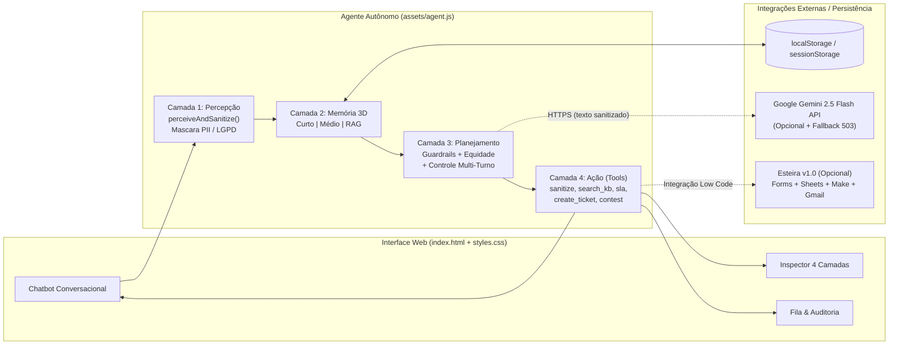
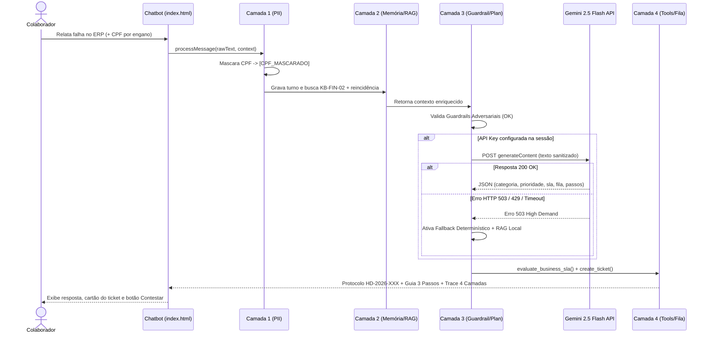
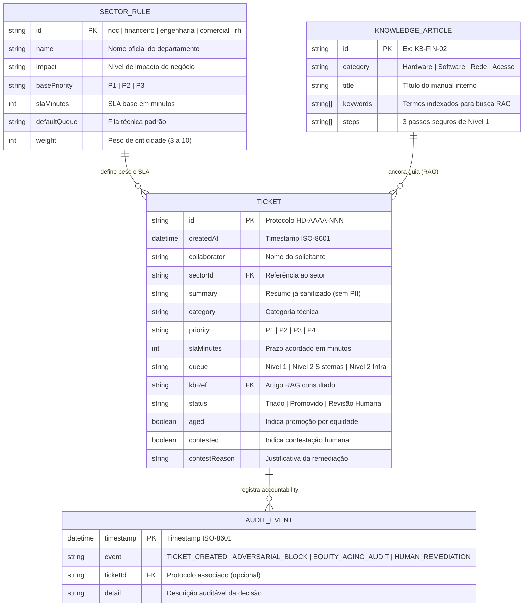

# 03. Arquitetura do Agente Autônomo (4 Camadas), Modelo de Dados e APIs

> **Sistema:** HelpDesk AI 2.0 — NexusTech S.A.  
> **Foco Técnico:** Evolução de Modelo Generativo Estático para Agente Autônomo de 4 Camadas, Gestão de Memória 3D, Modelo de Dados e Contratos de API.

---

## 1. Modelo Generativo Estático vs. Agente Autônomo

Um dos pilares conceituais da disciplina (Avaliação A1) é distinguir um **Modelo Generativo (LLM isolado)** de um **Agente Autônomo**. A tabela abaixo registra exatamente o salto arquitetural dado entre o **HelpDesk AI v1.0** e o **HelpDesk AI v2.0**:

| Critério | Modelo Generativo Estático (v1.0) | Agente Autônomo HelpDesk AI (v2.0) |
| :--- | :--- | :--- |
| **Interação** | Disparo único (*single-turn*): recebe formulário e devolve texto. | Diálogo adaptativo (*multi-turn*): pede esclarecimento se o relato for vago. |
| **Memória** | Sem estado (*stateless*): esquece o usuário assim que responde. | **3 dimensões de memória:** Curto Prazo (sessão), Médio Prazo (histórico/reincidência) e Longo Prazo (RAG). |
| **Ação no Ambiente** | Apenas gera texto; depende totalmente de fluxo externo fixo. | Planeja e invoca **ferramentas estruturadas (Tools)** com entrada/saída JSON auditável. |
| **Segurança e Privacidade** | Depende apenas de instruções textuais no prompt. | Camada dedicada de **Privacy by Design (filtro PII)** + **Guardrails Adversariais** antes da LLM. |
| **Resiliência e Ética** | Falha se a API retornar HTTP 503; sem recurso para o usuário contestar. | **Fallback automático** em HTTP 503, auditoria de equidade (*aging*) e **remediação humana**. |

---

## 2. Arquitetura de 4 Camadas do Agente Autônomo

O motor implementado em [`assets/agent.js`](../assets/agent.js) organiza a cognição do sistema em quatro camadas desacopladas:



### Detalhamento das 4 Camadas
1. **Camada 1 — Percepção e *Privacy by Design* (`perceiveAndSanitize`):** Normaliza a entrada, mede tamanho do texto e executa expressões regulares de alta precisão para mascarar CPF, cartões de crédito, chaves de API (`AIza...`, `sk-...`), senhas declaradas e e-mails pessoais antes que o dado avance no pipeline.
2. **Camada 2 — Gestão de Memória em 3 Dimensões:**
   * **Curto Prazo (`shortTermMemory` + `pendingClarification`):** Armazena até os últimos 12 turnos da conversa em RAM e mantém contexto pendente quando o usuário precisa complementar um relato vago. *Risco de privacidade mitigado:* descartada automaticamente ao fechar ou atualizar a aba.
   * **Médio Prazo (`localStorage` — `helpdesk_ai_v2_tickets`):** Mantém o histórico de chamados da sessão/usuário, permitindo detectar **reincidência** (regra de equidade RN-06). *Risco de privacidade mitigado:* textos já entram mascarados pela Camada 1 e o usuário tem controle explícito de exclusão pelo botão *Limpar Memória (LGPD)*.
   * **Longo Prazo (`KNOWLEDGE_BASE` — RAG Corporativo):** Base estruturada de conhecimento contendo 6 manuais técnicos verificados (`KB-NOC-01`, `KB-FIN-02`, `KB-ENG-03`, `KB-CX-04`, `KB-RH-05`, `KB-SEC-06`), recuperados por pontuação semântica ponderada por setor para ancorar as respostas e eliminar alucinações.
3. **Camada 3 — Planejamento, Controle de Fluxo e Governança Ética:** Orquestra a ordem de decisão: avalia risco adversarial (`evaluateAdversarialRisk`), identifica intenções especiais (consulta de protocolo `HD-AAAA-NNN` ou necessidade de esclarecimento multi-turno), invoca o modelo Gemini (se configurado) com fallback resiliente e aplica a política de equidade/reincidência.
4. **Camada 4 — Ação (Execução de Ferramentas / Tools):** Executa e registra as chamadas de ferramentas com entrada e saída estruturadas (`sanitize_pii`, `search_knowledge_base`, `evaluate_business_sla`, `create_ticket`, `query_ticket_status`, `request_clarification`, `activate_fallback_contingency`), gravando a trilha de *Accountability*.

---

## 3. Diagrama de Sequência (Execução de um Chamado com API e Fallback)



---

## 4. Stack Tecnológica Completa

| Camada | Tecnologia | Papel na Arquitetura |
| :--- | :--- | :--- |
| **Frontend & Agente (v2.0)** | HTML5, CSS3 (Editorial Technical Dark Mode), JavaScript ES6+ Vanilla | Interface conversacional, motor do agente de 4 camadas, painel de inspeção, fila de equidade e suíte de testes sem build externo. |
| **Persistência Local (v2.0)** | Web Storage API (`localStorage` + `sessionStorage`) | Memória de médio prazo, trilha de auditoria e armazenamento volátil da API Key (Privacy by Design). |
| **IA Generativa (Vibecode)** | Google Gemini API (`gemini-2.5-flash` via REST / JSON Mode) | Inferência semântica opcional ao vivo com resposta estruturada em JSON. |
| **Automação em Nuvem (v1.0)** | Google Forms, Google Sheets, Make.com (`Parse JSON`) e Gmail | Esteira assíncrona No Code / Low Code integrada para coleta via formulário, planilha colorida e despacho de e-mail HTML. |
| **Hospedagem e Versionamento** | Git, GitHub e GitHub Pages | Controle de versão, documentação técnica e publicação direta do `index.html`. |

### 4.1 Comparativo de Ferramentas de Chatbot (Avaliação 12/nov)

Antes de implementar a interface conversacional da versão 2.0, avaliamos as principais ferramentas de mercado para construção de chatbots corporativos em relação às restrições acadêmicas e técnicas do projeto (custo zero, transparência das 4 camadas do agente, privacidade PII pré-envio e facilidade de execução pela banca):

| Ferramenta de Chatbot | Tipo / Paradigma | Pontos Fortes | Limitações para o HelpDesk AI 2.0 | Decisão |
| :--- | :--- | :--- | :--- | :--- |
| **Google Dialogflow CX** | Low Code / NLU Gerenciado | Fluxos visuais maduros, integração telefonia/Google Cloud. | Exige conta de faturamento (cartão) no GCP para recursos avançados e esconde a telemetria interna das 4 camadas. | Não adotada |
| **Botpress** | Low Code + LLM | Conector visual de base de conhecimento e agentes prontos. | Limites de mensagens/tokens no plano gratuito e dependência de nuvem proprietária (lock-in). | Não adotada |
| **Typebot** | No Code / Open-Source | Interface conversacional limpa e fácil de embutir. | Focado em árvores determinísticas de formulário; não permite executar filtro PII local nem auditoria de *Aging* no cliente. | Não adotada |
| **Rasa Open Source** | Code-First (Python) | Controle total de NLU/políticas e hospedagem on-premise. | Exige instalação pesada de Python/Docker e servidor dedicado, inviabilizando abertura em 1 clique no GitHub Pages. | Não adotada |
| **Web Customizada (`index.html`) + Gemini API + Make (Adotada)** | Híbrida (No/Low/Vibecode + Vanilla JS) | **Custo zero**, abertura imediata via **GitHub Pages**, mascaramento PII *antes* da rede, painel ao vivo das 4 camadas, fallback automático em HTTP 503 e 24 testes executáveis no navegador. | Persistência local limitada ao navegador na demo web (mitigada pela integração paralela com Google Sheets/Make na v1.0 e exportação JSON). | **Adotada** |

### 4.2 Projetos de Referência e Diferenciação
O desenho do sistema inspirou-se em arquiteturas reais de *ITSM Automation* e assistentes auditáveis (como pipelines de triagem com regras explicáveis combinadas a classificadores/LLMs, mascaramento prévio de dados pessoais e testes automatizados de viés e segurança), diferenciando-se por unir **IA Generativa + Agente de 4 Camadas + Licença Social (Remediação Humana)** em uma entrega acessível sem instalação local.

---

## 5. Modelo de Dados e Dicionário de Dados

### 5.1 Diagrama Entidade-Relacionamento (DER)



### 5.2 Dicionário de Dados (Entidade Principal `TICKET`)

| Campo | Tipo | Obrigatório | Regra / Restrição |
| :--- | :--- | :--- | :--- |
| `id` | `string` | Sim | Chave única sequencial no formato `HD-2026-NNN`. |
| `createdAt` | `ISO-8601 string` | Sim | Gerado automaticamente em UTC no momento da criação. |
| `collaborator` | `string` | Sim | Nome do colaborador solicitante (padrão sanitizado). |
| `sectorId` | `enum` | Sim | Domínio fechado: `noc`, `financeiro`, `engenharia`, `comercial`, `rh`. |
| `summary` | `string` (max 92) | Sim | Texto **obrigatoriamente sanitizado pela Camada 1** (zero PII). |
| `priority` | `enum` | Sim | Valores permitidos: `P1`, `P2`, `P3`, `P4`. |
| `slaMinutes` | `integer` | Sim | Intervalo válido: `15` a `1440` minutos. |
| `kbRef` | `string` | Sim | Identificador do artigo RAG (`KB-XXX-00` ou `KB-GEN-00`). |
| `aged` | `boolean` | Sim | `true` se o ticket foi promovido pela auditoria de equidade. |
| `contested` | `boolean` | Sim | `true` se o usuário acionou o mecanismo de remediação humana. |

---

## 6. APIs e Contratos de Integração

### 6.1 Contrato da API Google Gemini (Modo Live Opcional)
* **Endpoint:** `POST https://generativelanguage.googleapis.com/v1beta/models/gemini-2.5-flash:generateContent?key={API_KEY}`
* **Autenticação:** Query parameter `key` lido exclusivamente de `sessionStorage` (`helpdesk_gemini_key`).
* **Content-Type:** `application/json`

**Payload de Requisição (Exemplo):**
```json
{
  "systemInstruction": {
    "parts": [
      {
        "text": "Você é o Agente Autônomo HelpDesk AI da NexusTech S.A. Responda EXCLUSIVAMENTE em JSON válido..."
      }
    ]
  },
  "contents": [
    {
      "role": "user",
      "parts": [
        {
          "text": "O sistema ERP travou ao emitir notas fiscais no fechamento. Meu CPF [CPF_MASCARADO]."
        }
      ]
    }
  ],
  "generationConfig": {
    "temperature": 0.2,
    "responseMimeType": "application/json"
  }
}
```

**Contrato de Resposta Estruturada (JSON Esperado pelo Agente e pelo `Parse JSON` do Make):**
```json
{
  "categoria": "Software",
  "prioridade": "P1",
  "sla": "30 minutos",
  "fila": "Nível 2 Sistemas",
  "resumo_tecnico": "Indisponibilidade no módulo de emissão fiscal do ERP.",
  "passos": [
    "Verifique a estabilidade da VPN corporativa da NexusTech.",
    "Encerre o processo do ERP, limpe o cache da sessão e realize novo login.",
    "Confirme o reconhecimento do certificado digital A1/A3 na estação."
  ]
}
```

### 6.2 Contratos das Ferramentas Internas do Agente (Camada 4 — Tools)

| Ferramenta (`tool`) | Contrato de Entrada | Contrato de Saída |
| :--- | :--- | :--- |
| `sanitize_pii` | `{ "chars": number }` | `{ "redacted": number, "types": string[] }` |
| `search_knowledge_base` | `{ "query": string, "sector": string }` | `{ "kbId": string, "title": string, "matched": string[] }` |
| `evaluate_business_sla` | `{ "sector": string, "recurrence": number }` | `{ "priority": string, "sla": string, "queue": string }` |
| `create_ticket` | `{ "sector": string, "priority": string, "queue": string }` | `{ "ticketId": string, "persisted": boolean }` |
| `query_ticket_status` | `{ "ticketId": string }` | `{ "found": boolean, "status": string, "priority": string }` |
| `activate_fallback_contingency` | `{ "error": string }` | `{ "mode": "LOCAL_DETERMINISTIC_RAG", "availability": "100%" }` |

### 6.3 Tratamento de Códigos de Erro HTTP

| Código HTTP | Significado | Ação Implementada no HelpDesk AI 2.0 |
| :--- | :--- | :--- |
| `200 OK` | Inferência JSON recebida com sucesso. | Valida schema (`prioridade`, `passos`), cria ticket e exibe resposta. |
| `400 Bad Request` | Payload malformado ou prompt inválido. | Registra falha e ativa fallback local determinístico. |
| `401 / 403` | Chave de API inválida ou sem permissão. | Aciona fallback local e notifica na telemetria sem travar o chat. |
| `429 Too Many Requests` | Cota por minuto da camada gratuita excedida. | Aciona fallback local + registra evento na Camada 4. |
| `500 / 503` | Erro interno ou *High Demand* nos servidores da API (vivenciado nos testes reais). | Executa `activate_fallback_contingency()`, conclui a triagem via base RAG local e exibe aviso transparente ao usuário. |
