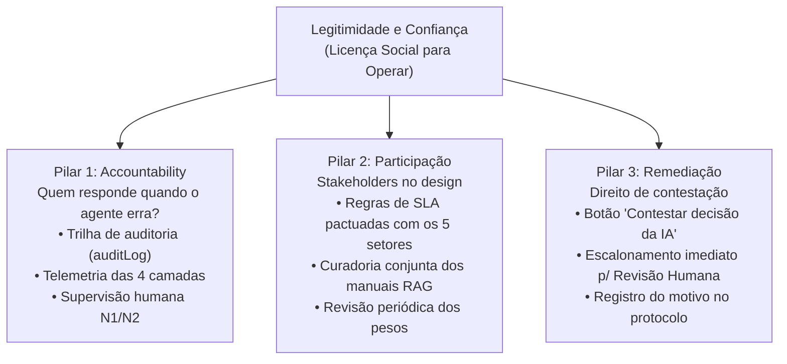

# 04. Ética Aplicada, Privacy by Design, Vieses e Licença Social para Operar

> **Sistema:** HelpDesk AI 2.0 — NexusTech S.A.  
> **Alinhamento Acadêmico:** Aplicação prática dos frameworks da Avaliação A1 — Eysenck & Eysenck (2023), Mello (2024) e Córdova (2025).

---

## 1. Privacy by Design e Gestão das 3 Dimensões de Memória

Um agente autônomo precisa de memória para manter contexto, aprender padrões e consultar manuais. Contudo, cada dimensão de memória introduz riscos específicos à privacidade sob a **LGPD (Lei 13.709/2018)**. No **HelpDesk AI 2.0**, adotou-se *Privacy by Design* desde a arquitetura:

| Dimensão de Memória | Implementação no HelpDesk AI 2.0 | Risco de Privacidade Associado | Mitigação Aplicada no Código |
| :--- | :--- | :--- | :--- |
| **1. Curto Prazo** | Array `shortTermMemory` (últimos 12 turnos) e `pendingClarification` em memória RAM da aba. | Exposição acidental de senhas ou CPF digitados durante o diálogo. | Interceptação prévia na Camada 1 (`perceiveAndSanitize`) antes de gravar no array; descarte automático ao fechar a aba. |
| **2. Médio Prazo** | Histórico de chamados do colaborador em `localStorage` (`helpdesk_ai_v2_tickets`) para detectar reincidência. | Retenção indefinida de histórico pessoal em estação compartilhada. | Armazenamento exclusivo de texto já sanitizado + botão explícito **Limpar Memória (LGPD)** (`forgetUserMemory()`) garantindo direito à eliminação. |
| **3. Longo Prazo (RAG)** | Base `KNOWLEDGE_BASE` contendo 6 procedimentos internos (`KB-NOC-01` a `KB-SEC-06`). | Vazamento de segredos operacionais ou credenciais embutidas nos manuais. | Base curada apenas com procedimentos públicos de Nível 1; zero senhas, IPs internos sensíveis ou dados pessoais na KB. |

### Proteção de Credenciais de API
A chave opcional da API do Google Gemini nunca é gravada no repositório público nem em `localStorage`. Ela é mantida exclusivamente em `sessionStorage`, sendo destruída automaticamente ao encerrar a sessão do navegador, e apenas recebe o texto **já sanitizado** pela Camada 1.

---

## 2. Identificação e Mitigação de Vieses (Dados, Algoritmo e Aplicação)

Seguindo o checklist de avaliação crítica da disciplina, mapeamos os três tipos clássicos de viés diretamente no cenário da **NexusTech S.A.**:

### 2.1 Viés de Dados
* **Risco no HelpDesk AI:** Se o sistema dependesse apenas de termos técnicos sofisticados nos manuais de treinamento (ex.: "timeout no gateway", "token SSH"), colaboradores menos técnicos de áreas administrativas ou comerciais — que escrevem com erros de digitação (ex.: *"não consigo abrir o exel"*) ou linguagem informal — receberiam classificações piores ou falhas de categorização.
* **Mitigação:** A busca RAG indexa sinônimos coloquiais e variações sem acentuação, e o controle multi-turno (`CLARIFICATION_REQUIRED`) faz perguntas simples em vez de descartar ou rebaixar relatos menos técnicos.

### 2.2 Viés de Algoritmo
* **Risco no HelpDesk AI:** Modelos generativos podem associar palavras emotivas ou tom agressivo a uma urgência maior (recompensando quem "grita mais alto") ou, inversamente, punir usuários irritados rebaixando sua prioridade. Além disso, podem ocorrer correlações indevidas com variáveis indiretas (*proxies*), como o nome ou o estilo de escrita do solicitante.
* **Mitigação:** O cálculo de prioridade (`evaluateBusinessSla`) é blindado contra o nome do colaborador e contra hostilidade verbal (`HOSTILE_TONE` é sinalizado apenas para postura profissional, sem penalizar o SLA). A ponderação depende estritamente do impacto setorial e da gravidade objetiva do sintoma.

### 2.3 Viés de Aplicação (Inanição Estrutural / *Starvation*)
* **Risco no HelpDesk AI:** Ao atribuir pesos altos para NOC (`10`) e Financeiro (`8`) e peso baixo para RH/Admin (`3`), uma aplicação estritamente utilitarista poderia fazer com que chamados do RH nunca fossem atendidos em dias de pico — criando injustiça organizacional sistemática.
* **Mitigação:** Implementação da **Política de Equidade (RN-06)** com dois mecanismos ativos:
  1. Promoção automática de prioridade em caso de **reincidência** detectada na Memória de Médio Prazo.
  2. **Auditoria de Equidade (Aging)** (`runEquityAgingAudit`), que promove chamados P3/P4 antigos na fila para impedir inanição crônica.

---

## 3. Mitigação e o Custo da Equidade (Eysenck & Eysenck, 2023)

> *"IA sem auditoria de viés é IA sem responsabilidade."* — Eysenck & Eysenck (2023)

O projeto evidencia na prática a balança entre **Eficiência Técnica** e **Justiça Social/Organizacional**:
* **Eficiência Técnica pura** ditaria atender 100% dos incidentes do NOC e Financeiro antes de qualquer chamado do RH, maximizando a proteção imediata de receita.
* **Justiça e Equidade** reconhecem que uma falha no RH (ex.: fechamento de folha de pagamento ou admissão bloqueada) também impacta diretamente pessoas reais. Sacrificar uma fração mínima de eficiência imediata — promovendo tickets antigos via *Aging* e permitindo contestação humana — é o "custo da equidade" necessário para que o sistema seja justo e aceito por toda a organização.
* **Estratégias contínuas adotadas:** auditorias regulares de equidade na aba *Fila & Equidade*, monitoramento de variáveis correlacionadas (*proxies*) e revisão multidisciplinar dos pesos entre os 5 departamentos.

---

## 4. Avaliação Crítica Além de Acurácia e Latência (Mello, 2024)

> *"Acurácia e latência são insuficientes para agentes de impacto social."* — Mello (2024)

Embora o protótipo alcance `100%` de acerto nos 9 cenários automatizados com latência média inferior a `1 ms` no motor local, avaliamos o agente nas três dimensões críticas propostas por Mello (2024):

| Dimensão | Pergunta Norteadora | Como o HelpDesk AI 2.0 Atende e Mede |
| :--- | :--- | :--- |
| **Confiança** | *O usuário sente que é tratado de forma justa?* | O agente explica explicitamente qual setor e qual manual interno (`KB-XXX`) fundamentaram o SLA, exibe suas 4 camadas em tempo real e oferece botão transparente de contestação. |
| **Robustez** | *Como o sistema lida com cenários fora do padrão ou ataques?* | Validado no Painel de Testes com ataques de *Prompt Injection* (`TC-04`), pedidos destrutivos (`TC-05`), relatos vagos (`TC-08`) e simulação de indisponibilidade `HTTP 503` com fallback automático (`TC-07`). |
| **Impacto** | *Qual o efeito real na rotina das pessoas?* | Reduz a ansiedade de espera entregando orientação acionável em segundos, evita que equipes administrativas sofram negligência (*aging*) e preserva o emprego dos analistas N1/N2 para problemas complexos em vez de triagem mecânica. |

---

## 5. Responsabilidade Social e Licença de Operação (Córdova, 2025)

> *"Sistemas autônomos precisam de mais do que código limpo; precisam de uma Licença Social para Operar."* — Córdova (2025)

A legitimidade do **HelpDesk AI 2.0** na NexusTech S.A. sustenta-se nos três pilares formais:

1. **Pilar 1 — Accountability (Responsabilização):** A responsabilidade final por qualquer atendimento nunca é transferida "para a IA". Todo protocolo mantém vínculo explícito com uma fila humana (`Nível 1 Suporte`, `Nível 2 Sistemas` ou `Nível 2 Infraestrutura`), e cada ação do agente (criação de ticket, mascaramento PII, bloqueio adversarial, fallback ou promoção por *aging*) fica registrada com timestamp na tabela de auditoria.
2. **Pilar 2 — Participação:** A definição da matriz de criticidade e dos manuais de autoatendimento (base RAG) prevê governança participativa com representantes dos cinco departamentos da NexusTech antes da entrada em produção, evitando imposição unilateral pela TI.
3. **Pilar 3 — Remediação:** Em vez de uma decisão algorítmica irreversível, o usuário dispõe do botão **Contestar decisão da IA** tanto no chat quanto na tabela da fila, garantindo revisão humana formal e reparação rápida em caso de subestimação de urgência.

---

## 6. Síntese — Checklist de Preparação A1 Atendido

1. **Diferenciar Modelo Generativo de Agente Autônomo:** Documentado comparativamente em [`03_arquitetura_agente_e_dados.md`](03_arquitetura_agente_e_dados.md) e demonstrado na evolução v1.0 -> v2.0.
2. **Mapear as 4 camadas de arquitetura de um agente:** Implementadas no código (`assets/agent.js`) e visíveis em tempo real no painel lateral do `index.html`.
3. **Entender as 3 dimensões de memória e riscos de privacidade:** Curto, Médio e Longo Prazo (RAG) com filtro PII e botão *Limpar Memória (LGPD)*.
4. **Identificar vieses (Dados, Algoritmo, Aplicação) e propor mitigações:** Mapeados na Seção 2 e mitigados via busca inclusiva, blindagem contra tom hostil, reincidência e *Aging*.
5. **Aplicar frameworks éticos a um estudo de caso real:** Eysenck & Eysenck (2023), Mello (2024) e Córdova (2025) aplicados concretamente à **NexusTech S.A.**.
